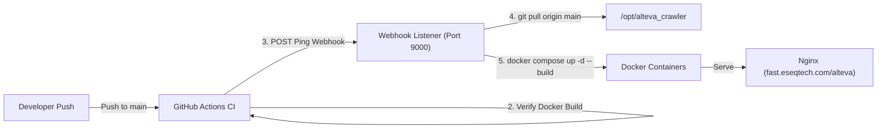

# 🚀 Deployment & Webhook Ping Architecture

This guide explains how **GitHub Actions CI** triggers automated deployment on your server when a new build completes on `main`.

---

## 🏗️ Architecture Overview



---

## 1. Server Webhook Setup (`scripts/deploy-webhook.py`)

On your server, run the lightweight Python webhook script (`scripts/deploy-webhook.py`) as a background service or systemd unit:

### Systemd Service Setup (`/etc/systemd/system/alteva-webhook.service`)
```ini
[Unit]
Description=Alteva Crawler Deploy Webhook Listener
After=network.target docker.service

[Service]
Type=simple
User=root
WorkingDirectory=/opt/alteva_crawler
Environment="PORT=9000"
Environment="WEBHOOK_SECRET=your-secure-random-secret"
Environment="PROJECT_DIR=/opt/alteva_crawler"
ExecStart=/usr/bin/python3 /opt/alteva_crawler/scripts/deploy-webhook.py
Restart=always

[Install]
WantedBy=multi-user.target
```

Enable and start the webhook service:
```bash
systemctl daemon-reload
systemctl enable --now alteva-webhook
```

---

## 2. Nginx Reverse Proxy Config (`fast.eseqtech.com`)

Add the following location blocks inside your Nginx server config (e.g. `/etc/nginx/sites-available/eseq`):

```nginx
server {
    listen 80;
    listen 443 ssl http2;
    server_name fast.eseqtech.com;

    # 1. Main Web UI Application
    location /alteva/ {
        proxy_pass http://127.0.0.1:3000/;
        proxy_http_version 1.1;

        # SignalR WebSocket support
        proxy_set_header Upgrade $http_upgrade;
        proxy_set_header Connection "Upgrade";

        proxy_set_header Host $host;
        proxy_set_header X-Real-IP $remote_addr;
        proxy_set_header X-Forwarded-For $proxy_add_x_forwarded_for;
        proxy_set_header X-Forwarded-Proto $scheme;
    }

    # 2. Deployment Webhook Ping
    location /alteva-webhook {
        proxy_pass http://127.0.0.1:9000;
        proxy_http_version 1.1;
        proxy_set_header Host $host;
        proxy_set_header X-Real-IP $remote_addr;
    }
}
```

Reload Nginx:
```bash
nginx -t && systemctl reload nginx
```

---

## 3. GitHub Repository Secrets Configuration

In your GitHub repository (**Settings** -> **Secrets and variables** -> **Actions**), add:

| Secret Name | Description | Example Value |
| :--- | :--- | :--- |
| `DEPLOY_WEBHOOK_URL` | Webhook URL on your server | `https://fast.eseqtech.com/alteva-webhook` |
| `DEPLOY_WEBHOOK_SECRET` | Secret bearer token matching `WEBHOOK_SECRET` | `your-secure-random-secret` |

---

## 4. How It Works on New Commits

1. Push commit to `main`.
2. GitHub Actions builds .NET 8 solution, executes 50 unit tests, and compiles React UI.
3. Upon test pass, GitHub Actions sends an HTTP POST request to `https://fast.eseqtech.com/alteva-webhook` with `Authorization: Bearer <WEBHOOK_SECRET>`.
4. The server receives the ping, runs `git pull origin main`, and re-launches Docker containers (`docker compose up -d --build`).
5. Updated app becomes live immediately at `https://fast.eseqtech.com/alteva/`.
