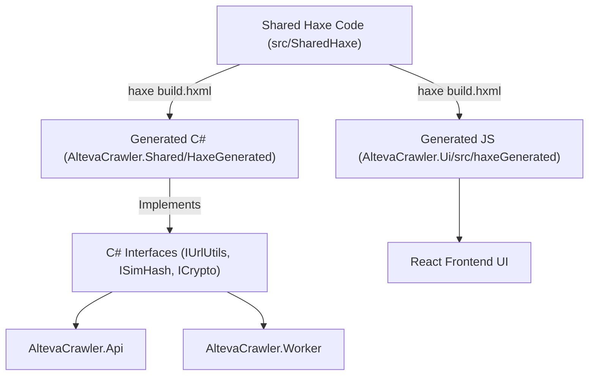

# Cross-Target Architecture: Haxe & Contract Interfaces

This document explains the choice of **Haxe** as a unified cross-compiler for shared domain utilities across C# (.NET 8) and JavaScript/TypeScript (React UI), and compares this approach with OpenAPI/NSwag code generation.

---

## 🚀 Why Haxe for Shared Domain Logic?

In a distributed web crawler system, certain procedural utilities must execute with **identical behavior** on both the C# backend worker/API and the browser React client.

Rather than maintaining duplicate implementations in two languages, **Haxe** acts as a single source of truth:



### Shared Logic Procedures
1. **CRC32 & Domain Hash Calculation**: Ensures identical integer hash values on both C# and browser JS.
2. **64-bit SimHash Fingerprinting**: Matches word tokens and produces 64-bit integer fingerprints for Hamming distance calculation.
3. **Symmetric HMAC Session Token Signing**: Shared token generation and validation algorithms.

---

## 🔒 Contract Enforcement via C# Interfaces

To guarantee that Haxe-generated C# output seamlessly conforms to the rest of the .NET solution and never diverges, explicit C# interfaces are declared in `AltevaCrawler.Shared/Contracts/IHaxeUtils.cs`:

```csharp
public interface IUrlUtils
{
    uint ComputeCrc32(string input);
    string ExtractDomain(string url);
}

public interface ISimHash
{
    int ComputeSimHash32(string text);
    int HammingDistance(float h1, float h2);
}

public interface ICrypto
{
    string CreateSimpleAuthToken(string sessionId, string secretKey);
    bool VerifySimpleAuthToken(string token, string secretKey);
}
```

The C# wrapper class `HaxeUtilsImpl` implements these interfaces by delegating directly to the compiled Haxe classes (`UrlUtils`, `SimHash`, `Crypto`), verified by automated xUnit parity tests in `tests/AltevaCrawler.Tests/UnitTests.cs`.

---

## ⚖️ Comparison: Haxe vs. OpenAPI / NSwag

While **OpenAPI (Swagger) and NSwag** are industry standards for generating HTTP DTOs and client proxies from REST endpoint definitions, **Haxe fills a complementary role**:

| Feature | OpenAPI / NSwag | Haxe Cross-Target Compilation |
|---|---|---|
| **Primary Scope** | REST DTOs, HTTP routes, client SDKs | Procedural algorithms & domain math |
| **Output** | C# / TS DTO classes & fetch client | Binary-compiled executable C# & JS functions |
| **Execution Place** | Network edge (HTTP serialization) | CPU execution (in-memory algorithms) |
| **Parity Guarantee** | Guarantees matching HTTP payload shapes | Guarantees identical algorithm execution results |

In this project, **OpenAPI (`docs/openapi.yaml`)** defines the HTTP REST payload contracts, while **Haxe (`src/SharedHaxe`)** provides the shared procedural algorithms.
