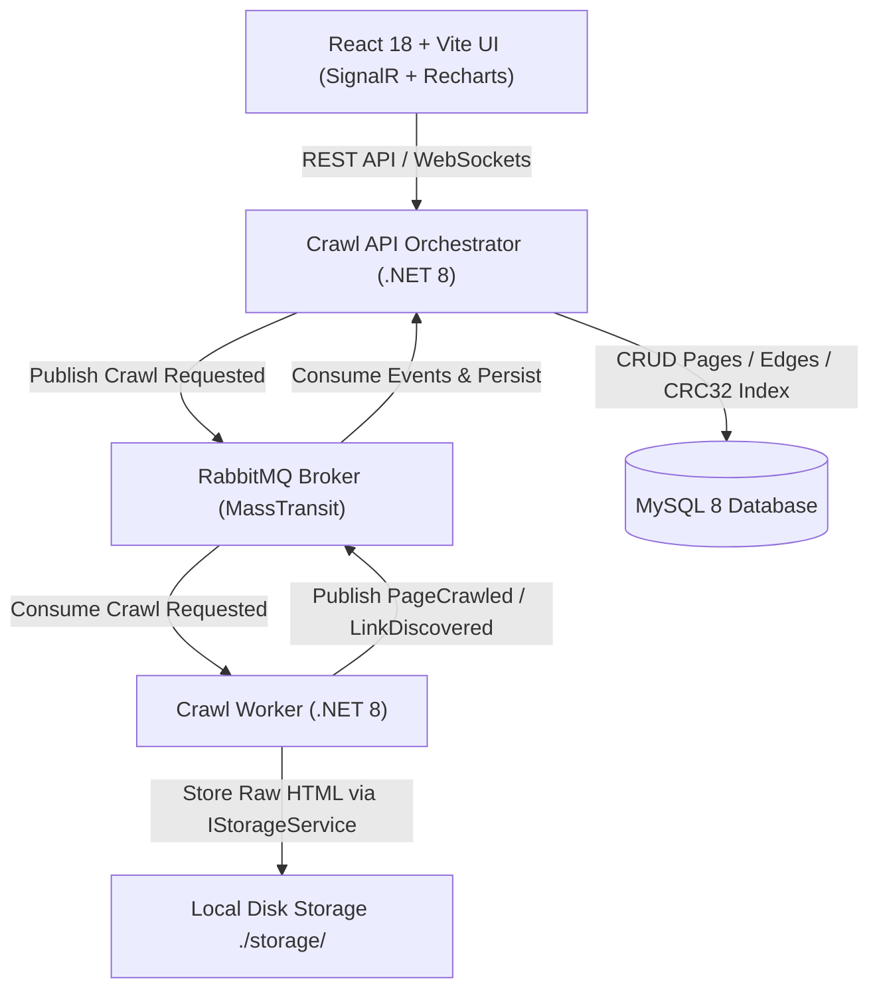
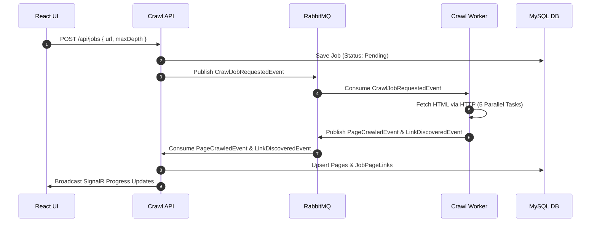

# Alteva Crawler — Distributed Job-Based Web Crawler System

A high-performance, event-driven web crawler built with **.NET 8**, **MassTransit + RabbitMQ**, **MySQL 8**, and **React 18 (Vite + TypeScript + Recharts + rc-tree)**.

- **[TRICKS.md](TRICKS.md)**: Database design insights, performance engineering tricks & optimization patterns.
- **[EDGE_CASES.md](EDGE_CASES.md)**: Network, Cloudflare, concurrency, and security edge cases.
- **[HAXE.md](HAXE.md)**: Cross-language logic sharing architecture (Haxe vs OpenAPI/NSwag).
- **[OpenAPI Spec](docs/openapi.yaml)**: OpenAPI 3.0 REST endpoint specification.

---

## 🏛️ System Architecture



---

## 📩 Event-Driven Message Flow



---

## ⚡ Key Highlights & Architecture Choices

1. **Stateless HMAC Session Token Authentication**:
   - Cryptographically signs session tokens (`Header.Payload.Signature`) using HMAC-SHA256.
   - Verified statelessly in-memory in `AuthFilter.cs` without querying MySQL.

2. **In-Memory & Database De-duplication**:
   - `Pages.UrlCrc32` (`INT UNSIGNED`) is a **persisted generated column** computed by MySQL as `CRC32(NormalizedUrl)` (`STORED`, indexed as `IX_Pages_UrlCrc32`). Code never assigns it; lookups filter on the integer first and then compare the exact URL. MySQL's `CRC32` over utf8mb4 bytes equals the C# `Crc32` over UTF-8 bytes (checked by a test against the real database). The index is not unique because CRC32 can collide.
   - The worker keeps a **per-job** in-memory `HashSet<uint>` of URL hashes (cleared when the job ends) to suppress duplicate URLs before any HTTP request. A shared cache across jobs was a bug: a second crawl of the same site skipped every link.

3. **Pluggable Storage Abstraction (`IStorageService`)**:
   - Features `LocalStorageService` (default disk file storage) and reference `MockS3StorageService` (S3 bucket storage pattern).

4. **Hierarchical Tree View & Reactive 3-Level Lazy Loading**:
   - UI uses `rc-tree` ready component to render discovered page graphs.
   - API lazy-loads 3 levels deep (`GET /api/jobs/{id}/tree?parentPageId=...&depth=3`).
   - Selecting a node opens a preview drawer showing the page's **extracted visible text** (scripts, styles and comments removed) with keyword highlighting. Text is rendered as React text nodes, never as HTML, so crawled pages cannot inject script (stored-XSS safe).

5. **64-bit SimHash & Bitwise Hamming Distance Search**:
   - Calculates a 64-bit SimHash fingerprint for crawled pages.
   - Search endpoints (`/api/jobs/{id}/search` and `/api/jobs/global-search`) compute query SimHash and rank results by bitwise Hamming distance (`popcount(hash1 ^ hash2)`).

6. **2D Live Progress Graph, Forecast & Metrics**:
   - **2D Area Chart**: Twin Y-axes (Yellow area for pages, Blue line for download bytes) with a smooth forecast continuation curve.
   - **Crawl history**: pages and bytes per point use the real stored `ByteSize` of each page, plus average pages/s and KB/s.
   - **Metrics**: Domain link ratio pie chart, unique vs shared pages bar chart, and "bytes saved" = total stored size of pages shared with other jobs.

7. **Time-Ordered Job IDs (`SequentialGuid`)**:
   - Job IDs use `SequentialGuid.NewSequentialGuid()`: a UUIDv7 layout (48-bit millisecond timestamp, 12-bit sequence, random tail) that works on .NET 8 (`Guid.CreateVersion7` needs .NET 9). Ids sort by creation time, which avoids random-insert B-tree page splits and makes date-range queries cheap. Random v4 is not needed because ids are not secrets (access is guarded by the session token).

8. **Resilient Health & Outage Reporting**:
   - API `GET /health` returns JSON status for the database (the broker field is not a real check yet).
   - Worker `GET /health` (port 5001) reports the MassTransit bus state.

---

## 💾 Page Content Storage

Page HTML content is decoupled from relational database records and managed via the `IStorageService` interface.

### Storage Architecture & Paths
- **Relative Path Resolution**: Crawled HTML pages are saved using relative file paths built by `StoragePathBuilder` (e.g., `example.com/blog/page1.txt`). Storing relative paths prevents host-specific directory paths in database records.
- **Collision-free names**: query strings are kept (`/search?q=a` and `/search?q=b` map to different files via a sanitised fragment plus an 8-hex hash), invalid file-name characters are replaced, and `index` is used for empty paths. Files use a `.txt` extension but hold the raw HTML.
- **Path Safety**: `LocalStorageService` checks `StoragePathBuilder.IsUnderRoot` on read, write and delete; a path that resolves outside the root is refused.
- **Metadata in MySQL**: only `StoragePath`, `ByteSize` and `SimHash` live in the database, so page bodies never bloat `Pages`. (`ContentHash` exists in the schema but the worker does not populate it yet.)
- **Trade-offs**: the database is no longer self-contained (backups must cover both the DB and the file store, and rows and files can drift apart; delete/prune removes both). Each job re-downloads pages other jobs already stored.

### Shared Volume Requirement (`/app/storage`)
- In multi-container Docker deployments (API & Worker), both containers **must mount a shared volume at `/app/storage`**.
- The Crawl Worker writes raw HTML files to `/app/storage/{relativePath}`, and the API Orchestrator reads from `/app/storage/{relativePath}` to serve raw page content and preview drawer requests.

- The storage root is `<working directory>/storage` for both services (`/app/storage` in containers). It is not yet configurable via `Storage:RootPath`.

### Cloud & S3 Storage Pattern
- The codebase provides `MockS3StorageService` demonstrating an object-store pattern (`s3://alteva-crawler-bucket/{domain}/{id}.html`).
- It is a reference only and is not wired by configuration; it generates a new object key per save.
- For multi-machine deployments a shared volume does not scale, so `IStorageService` should be backed by object storage. In production cloud environments it can be swapped via Dependency Injection to store page content directly in AWS S3 or Azure Blob Storage, eliminating the need for shared file system volumes.

---

## 🛡️ Reliability & Failure Handling

### Message schema (MassTransit, RabbitMQ)
| Event | Direction | Key fields |
|---|---|---|
| `CrawlJobRequestedEvent` | API → Worker | `JobId`, `Url`, `MaxDepth`, `MaxPagesLimit` |
| `PageCrawledEvent` | Worker → API | `JobId`, `Url`, `UrlCrc32`, `StatusCode`, `ByteSize`, `SimHash`, `StoragePath` (relative), `OutgoingLinksCount`. `IsSuccess` = 2xx and `ByteSize > 0` |
| `LinkDiscoveredEvent` | Worker → API | `JobId`, `SourceUrl`, `TargetUrl`, `TargetUrlCrc32`, `Depth` |
| `JobProgressUpdatedEvent` | Worker/API → API/UI | `JobId`, `Status` (`Completed`/`Failed`/`Paused`/`Canceled`), counts, `TotalBytesDownloaded`, `FailureReason` |
| `Cancel/Pause/ResumeJobRequestedEvent` | API → Worker | `JobId` |

### What counts as a crawled page
Only a stored 2xx HTML page counts toward `TotalPagesCrawled`, `TotalBytesDownloaded` and the page limit. These are recorded on the page row but **not** counted: 4xx/5xx responses (4xx is never retried), network errors and timeouts, non-HTML content types, and pages whose file could not be written (the write is retried once first).

### Job states
`Pending`, `Running`, `Paused`, `Completed`, `Failed`, `Canceled` (stored as `P R S C F X`, with a `JobStatusTransitions` audit row). An unexpected engine error publishes `Failed` with `FailureReason`; the job is not retried by the broker.

### Cancel, pause, resume
Each running job has its own `CancellationTokenSource`. Cancel stops the HTTP calls, file writes and publishes of that job, and the worker does not publish a final `Completed`. Cancellation is handled inside the engine, so the broker never sees it as a fault and never retries (and thereby restarts) a canceled job. Pause holds the queue between batches; resume releases it.

### Retries and DLQ
- HTTP: Polly retries transient failures (5xx, network errors, timeouts) with exponential backoff; 4xx is never retried.
- Messaging: the crawl consumer uses `UseMessageRetry` (2 retries, 2 s). A message that still fails is moved by MassTransit to the endpoint's default `<queue>_error` dead-letter queue (visible in the RabbitMQ management UI). This is the default behaviour and has not been customised or tested.
- Idempotency: see *Known Limitations*.

### Concurrency and limits
Up to 5 pages are fetched concurrently per job. `MaxPagesLimit` is enforced atomically (reserve a slot before storing; release it if the write fails), the last allowed page still publishes its links, and nothing is queued once the limit is reached.

---

## ⚠️ Known Limitations

- **Idempotency is partial**: there is no unique key on `Pages` or `JobPageLinks`, consumers do check-then-insert, and a redelivered `PageCrawledEvent` would double-count the job totals.
- CRC32 collisions are possible: the index on `UrlCrc32` is not unique, and the in-memory per-job set is keyed by the hash alone.
- No EF migrations (`EnsureCreated`). To cover older databases, the API runs an idempotent `SchemaUpgrader` at start-up that converts a plain `UrlCrc32` column to the generated column and adds a missing `Pages.ByteSize`; other schema changes still need the database to be recreated. `schema.sql` is a legodb export and is not what builds the DB.
- Pages are re-downloaded per job (no cross-job download reuse), so "bytes saved" only reports the size of pages shared with other jobs.
- `ContentHash` is not populated and SimHash is computed over the page text including script/style content.
- Pause/resume/cancel share the crawl queue and accept any job status; cancel before the job starts is not applied.
- Several settings (concurrency 5, retry counts, timeouts, connection fallbacks) are still hardcoded; the HMAC signing key is random per process, and the SignalR hub is unauthenticated.
- Several history/stat endpoints still use per-job queries and in-memory aggregation (see `docs/n-plus-one-replacements.md`).
- Audit trail: `docs/audit-report*.md` and `docs/code-review.md` track reviewed findings and their status.

---

## 🚀 How to Run Locally

### Option 1: Local Development Mode
```bash
# Clean active ports and start local background services
./start-local.sh

# Start React UI
cd src/AltevaCrawler.Ui
npm run dev
```

### Option 2: Multi-Container Docker Compose
```bash
docker-compose up --build
```
- React UI: `http://localhost:5173` (or `http://localhost:3000`)
- API Health Check: `http://localhost:5000/health`
- Worker Health Check: `http://localhost:5001/health`
- RabbitMQ Management: `http://localhost:15672` (guest / guest)

---

## 🧪 Running Unit Tests

```bash
dotnet test
```
All **53 tests** pass cleanly (the real-MySQL check runs only when `ALTEVA_TEST_MYSQL` is set, e.g. `Server=127.0.0.1;Port=3306;Uid=root;Pwd=...;`; it creates and drops a scratch database), covering:
- `Pages.UrlCrc32` is a stored generated column: model metadata, C# vs MySQL CRC32 test vectors, legacy-column upgrade and value parity on real MySQL
- URL normalization & lenient scheme prepending (`www.` stripping, allow-listing, query strings)
- Domain extraction & domain hash calculation
- Sequential GUID generation (`SequentialGuid.NewSequentialGuid()`) & time-ordering
- 64-bit SimHash calculation & Haxe 64-bit vs C# `SimHashCalculator` parity
- `IStorageService` file operations, query-string-safe storage paths & path safety
- Crawler engine (fake HTTP handler and publisher): cancellation, non-HTML/error pages not counted, strict max-pages limit, storage-failure handling, unexpected-error `Failed` status
- `PageCrawledEvent.IsSuccess` classification and `SequentialGuid` uniqueness under concurrency
- Haxe C# vs native C# parity
- Stateless HMAC session token creation & verification
