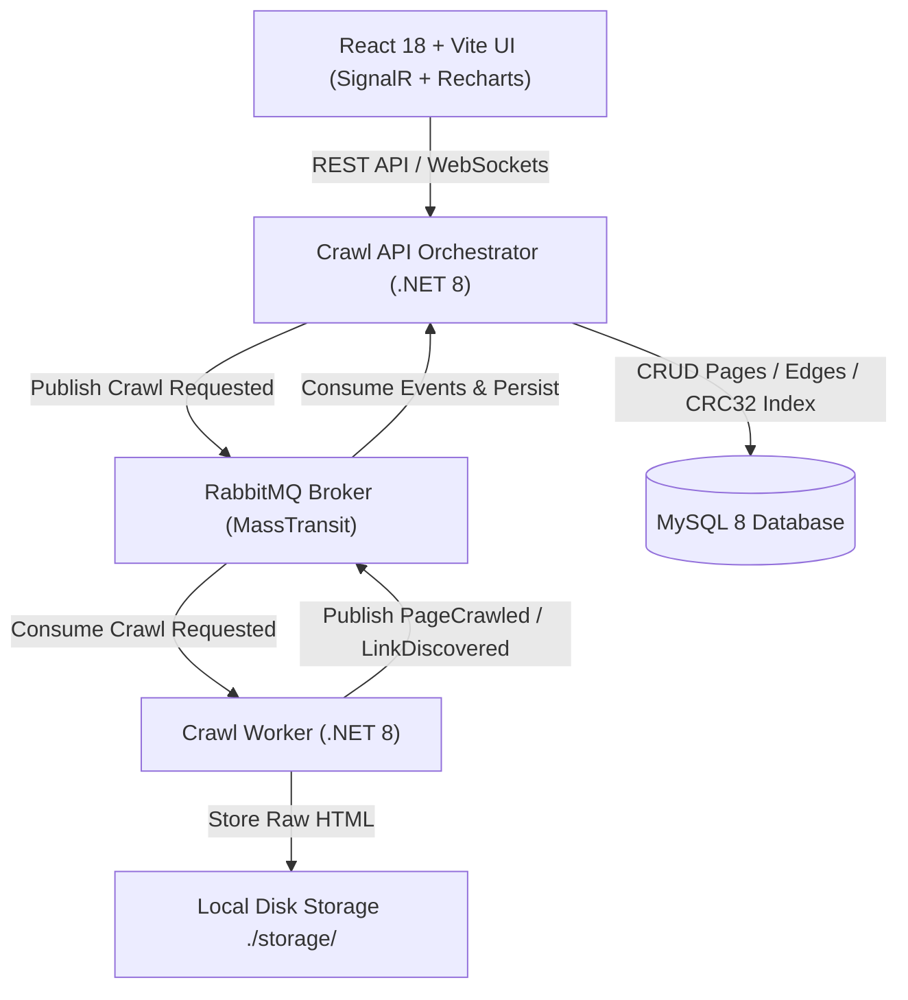

# Alteva Crawler — Distributed Job-Based Web Crawler System

A high-performance, event-driven web crawler built with **.NET 8**, **MassTransit + RabbitMQ**, **MySQL 8**, and **React 18 (Vite + TypeScript + Recharts + rc-tree)**.

For database design insights and performance engineering patterns, see **[TRICKS.md](TRICKS.md)**.  
For network, concurrency, and security edge cases, see **[EDGE_CASES.md](EDGE_CASES.md)**.

---

## 🏛️ System Architecture



---

## 📐 Key Database & Architecture Insights

1. **Persistent `url_crc32` Integer Index for $O(1)$ Deduplication**:
   - Uses an indexed `INT UNSIGNED` CRC32 hash column on `Pages` to replace slow string comparisons on long `VARCHAR(2048)` URLs.

2. **Database Ground Truth + In-Memory LRU Cache**:
   - The database stores all verified state as ground truth so crawling jobs can be paused, interrupted, or resumed at any time without data loss.

3. **Many-to-Many `JobPageLinks` Graph**:
   - Stores page content ONCE per URL in `Pages`, while many-to-many `JobPageLinks` records directed graph edges (`JobId`, `SourcePageId`, `TargetPageId`). Indexing `(JobId, SourcePageId)` and `(JobId, TargetPageId)` allows instant sub-page tree retrieval (with optional index disabling during bulk link imports).

4. **Time-Ordered UUID v7 Primary Keys**:
   - Job IDs use sequential `Guid.CreateVersion7()`, preventing MySQL InnoDB B-tree page splits and index fragmentation.

5. **Single `CHAR(1)` Status Column with Transition History**:
   - Uses `'P'`, `'R'`, `'C'`, `'F'`, `'X'` status characters for non-typesafe SQL script compatibility, while `JobStatusTransitions` table logs full state audit history.

6. **Stateless HMAC Session Token Verification**:
   - API middleware (`AuthFilter.cs`) verifies session tokens in memory statelessly without touching MySQL.

7. **64-bit SimHash & Hamming Distance Search**:
   - Computes 64-bit SimHash fingerprints and matches search keywords via bitwise XOR population count.

8. **Resilient Health & Outage Reporting**:
   - `GET /health` returns structured JSON status (`Healthy` / `Degraded`) for database and message queue connectivity.

---

## 🚀 How to Run Locally

### Option 1: Local Development Mode
```bash
# Clean active ports and start local background services
./start-local.sh

# Start React UI
cd src/AltevaCrawler.Ui
npm run dev
```

### Option 2: Multi-Container Docker Compose
```bash
docker-compose up --build
```
- React UI: `http://localhost:5173` (or `http://localhost:3000`)
- API Health Check: `http://localhost:5000/health`
- RabbitMQ Management: `http://localhost:15672` (guest / guest)

---

## 🧪 Running Unit Tests

```bash
dotnet test
```
All **28 unit tests** pass cleanly, covering:
- URL normalization & lenient scheme prepending (`www.` stripping, allow-listing, query strings)
- Domain extraction & domain hash calculation
- 64-bit SimHash calculation & Hamming distance
- Haxe C# vs native C# parity
- Stateless HMAC session token creation & verification
