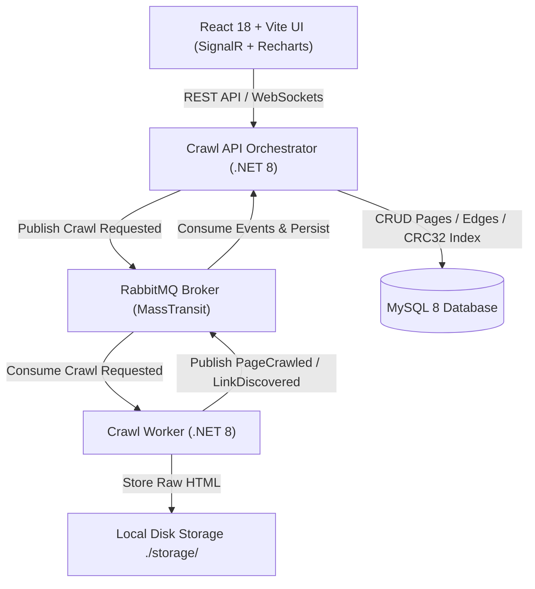
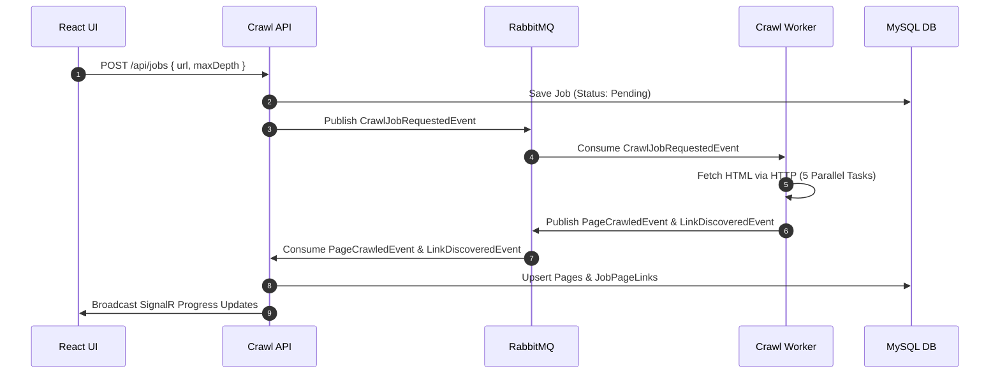

# Alteva Crawler — Distributed Job-Based Web Crawler System

A high-performance, event-driven web crawler built with **.NET 8**, **MassTransit + RabbitMQ**, **MySQL 8**, and **React 18 (Vite + TypeScript + Recharts + rc-tree)**.

For detailed performance engineering patterns, see **[TRICKS.md](TRICKS.md)**.  
For network, concurrency, and security edge cases, see **[EDGE_CASES.md](EDGE_CASES.md)**.

---

## 🏛️ System Architecture



---

## 📩 Event-Driven Message Flow



---

## ⚡ Key Highlights & Architecture Choices

1. **Stateless HMAC Session Token Authentication**:
   - Cryptographically signs session tokens (`Header.Payload.Signature`) using HMAC-SHA256.
   - Verified statelessly in-memory in `AuthFilter.cs` without querying MySQL.

2. **In-Memory & Database De-duplication**:
   - `Pages` table features a persistent generated column `url_crc32` with index `IX_Pages_UrlCrc32`.
   - Worker maintains an in-memory `ConcurrentDictionary<uint, string>` LRU cache to suppress duplicate URLs before issuing HTTP requests.

3. **Domain Link Ratio Calculated On-The-Fly**:
   - `domain_link_ratio` is computed dynamically when retrieving tree branches.
   - `domain_hash` (`INT UNSIGNED`) is indexed on `Pages` for fast domain `COUNT(*)` queries.

4. **Hierarchical Tree View & Reactive 3-Level Lazy Loading**:
   - UI uses `rc-tree` ready component to render discovered page graphs.
   - API lazy-loads 3 levels deep (`GET /api/jobs/{id}/tree?parentPageId=...&depth=3`).
   - Selecting a node opens a preview drawer showing raw HTML content with **query keyword highlighting (`<mark>`)**.

5. **64-bit SimHash & Bitwise Hamming Distance Search**:
   - Calculates a 64-bit SimHash fingerprint for crawled pages.
   - Search endpoints (`/api/jobs/{id}/search` and `/api/jobs/global-search`) compute query SimHash and rank results by bitwise Hamming distance (`popcount(hash1 ^ hash2)`).

6. **2D Live Progress Graph, Forecast & Metrics**:
   - **2D Area Chart**: Twin Y-axes (Yellow area for pages, Blue line for download bytes) with a smooth forecast continuation curve.
   - **Metrics**: Domain link ratio pie chart, unique vs shared pages bar chart, download shortcuts saved bandwidth.

7. **UUID v7 (Time-Ordered GUIDs)**:
   - Uses `Guid.CreateVersion7()` for jobs to prevent MySQL B-tree page fragmentation.

8. **Resilient Health & Outage Reporting**:
   - `GET /health` returns structured JSON status (`Healthy` / `Degraded`) for database and message queue connectivity.

---

## 🚀 How to Run Locally

### Option 1: Local Development Mode
```bash
# Clean active ports and start local background services
./start-local.sh

# Start React UI
cd src/AltevaCrawler.Ui
npm run dev
```

### Option 2: Multi-Container Docker Compose
```bash
docker-compose up --build
```
- React UI: `http://localhost:5173` (or `http://localhost:3000`)
- API Health Check: `http://localhost:5000/health`
- RabbitMQ Management: `http://localhost:15672` (guest / guest)

---

## 🧪 Running Unit Tests

```bash
dotnet test
```
All **28 unit tests** pass cleanly, covering:
- URL normalization & lenient scheme prepending (`www.` stripping, allow-listing, query strings)
- Domain extraction & domain hash calculation
- 64-bit SimHash calculation & Hamming distance
- Haxe C# vs native C# parity
- Stateless HMAC session token creation & verification
